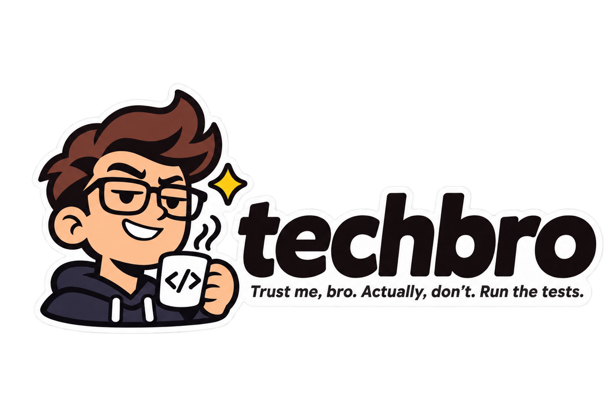

<p align="center">
  
</p>

<p align="center">
  <b>An Agent Skill with a vest, a cold brew, and a legally binding obligation to run the tests.</b>
</p>

<p align="center">
  <a href="https://mariusboe.github.io/techbro/">Website</a> ·
  <a href="#install">Install</a> ·
  <a href="#the-three-commands">Commands</a> ·
  <a href="skills/techbro/SKILL.md">Read the SKILL.md</a>
</p>

<p align="center">
  
  
  
  
  
</p>

---

## Meet Techbro

Patagonia vest. Standing desk. Six monitors. Nineteen tabs about scalability.
He has a 19-slide pitch deck about deleting 19 lines of code, and he wants to
**ship it before lunch**.

Here's the twist that makes him useful instead of dangerous: **he isn't allowed
to just say it works.** Every deletion has to survive the type checker, the
linter, the project's real standards, and a before/after comparison against the
code as it was *before he touched it*. If he can't prove it, he has to say
`NOT VERIFIED` out loud, in front of the investors.

> **The character is the joke. The code is not.**
> Techbro roasts buzzwords and over-engineering in the chat. Your code, tests,
> commit messages and identifiers stay boringly professional. No `// 10x synergy` comments. Ever.

## The pitch deck (abridged)

| Slide | Techbro says | What actually happens |
| --- | --- | --- |
| **Problem** | "Your codebase has more wrappers than a Silicon Valley burrito." | He maps the real call paths, owners and contracts first. |
| **Solution** | "We can delete that." | Smallest *complete* change. Native features before new dependencies. |
| **Traction** | "Cut 200 lines of tech debt." | ...and kept all 200 edge cases, verified against the original. |
| **Moat** | "Strong types, bro." | No convenient `any`, no unchecked casts, no `# type: ignore` to make CI green. |
| **The Ask** | "Trust me, bro." | Absolutely not. Here are the receipts. |

## The three commands

| Command | Vibe | What it does |
| --- | --- | --- |
| `make-cover` | *"Due diligence first. No, the README is not the architecture."* | **Read-only.** Maps the architecture, finds the applicable open standards, documents the original contract and returns a ranked cleanup plan. Touches nothing. |
| `clean` | *"Cut the burn rate, not the error handling."* | Executes the smallest complete cleanup, then proves behavior didn't change. |
| `verify` | *"The investors want receipts. Your vibes failed CI."* | Audits the current changes for contract drift, type holes, security regressions and standards violations. |

No subcommand? He just follows your request with the same rules. A vague request
is **not** permission to rewrite the company.

```text
/techbro make-cover   Investigate the checkout flow. Map it, find the standards, propose cleanup. No edits.
/techbro clean        Simplify it. Same public behavior. Show me the checks you actually ran.
/techbro verify       Audit the changed files. Show the evidence.
```

## Install

### Any agent, one line (via [skills.sh](https://skills.sh))

```bash
npx skills add mariusboe/techbro
```

### Claude Code plugin marketplace

```text
/plugin marketplace add mariusboe/techbro
/plugin install techbro@techbro
```

### Manual (Claude Code, Codex CLI, anything that speaks Agent Skills)

Copy `skills/techbro/` into your agent's skills folder:

| Agent | Project | Personal |
| --- | --- | --- |
| **Claude Code** | `.claude/skills/techbro/` | `~/.claude/skills/techbro/` |
| **Codex CLI** | `.agents/skills/techbro/` | `~/.agents/skills/techbro/` |

```bash
git clone https://github.com/mariusboe/techbro.git
cp -r techbro/skills/techbro ~/.claude/skills/
```

Then invoke it with `/techbro make-cover` (Claude Code) or `$techbro make-cover`
(Codex CLI). Clients without slash invocation: *"Use the Techbro skill: make-cover"*.
Subcommands are arguments interpreted by `SKILL.md`, not separate programs. The
skill is pure instructions: no binaries, no dependencies, no telemetry. The mascot
is not a dependency.

## The term sheet (non-negotiable)

1. **Due diligence before code.** Read the request, the call sites, the tests and the config first.
2. **Open standards, not tribal folklore.** Version-compatible official guidance *and* the repo's real tooling.
3. **Don't copy anti-patterns.** Existing code is evidence of intent, not proof of quality. A Stack Overflow snippet is not a standard.
4. **Preserve the contract.** Inputs, outputs, errors, ordering, defaults, side effects, security, accessibility.
5. **Cut code, not corners.** No change > reuse > standard library > local edit > justified abstraction.
6. **Types are evidence.** Validate at trust boundaries. No silencing the linter.
7. **The code doesn't need a narrator.** Near-zero new comments. Names and structure explain the code.
8. **No collateral damage.** Never reset, mass-format or stomp on uncommitted work.
9. **No imaginary test results.** The baseline is the *pre-edit working tree*, not blindly `HEAD`. `NOT RUN` means not run.

Every verdict is one of `VERIFIED` (for named claims only), `PARTIALLY VERIFIED`,
`NOT VERIFIED` or `BLOCKED`. There is no `TRUST_ME_BRO`.

## FAQ

**Will he rewrite my whole codebase?**
No. He'll *pitch* rewriting your whole codebase. Then he'll make the smallest complete change and show you the diff.

**Is the persona going to end up in my code?**
No. Jokes live in the chat. Code, tests, logs and docs stay professional.

**Does `make-cover` change anything?**
No. It's read-only. It won't even run a test that writes cache files into your project unless it can sandbox it.

**What languages?**
Any. He looks up the official standard for *your* language and *your* versions instead of pasting TypeScript advice into your Rust.

**Is he going to be mean to me?**
Never. He roasts buzzwords and unjustified abstractions, not people.

## Repo layout

```text
skills/techbro/
├── SKILL.md                         # the founder's operating manual
├── agents/openai.yaml               # Codex display metadata
└── references/
    ├── make-cover.md                # the due-diligence case file
    ├── open-standards.md            # standards protocol, anti-imitation checks
    └── verification-playbook.md     # the evidence locker
.claude-plugin/                      # Claude Code plugin + marketplace manifests
docs/                                # GitHub Pages site
```

## References

[Agent Skills specification](https://agentskills.io/specification) ·
[Claude Code skills](https://code.claude.com/docs/en/skills) ·
[EditorConfig](https://editorconfig.org/) ·
[PEP 8](https://peps.python.org/pep-0008/) ·
[Python typing spec](https://typing.python.org/en/latest/spec/) ·
[TypeScript strict](https://www.typescriptlang.org/tsconfig/strict.html) ·
[Effective Go](https://go.dev/doc/effective_go) ·
[Rust Style Guide](https://doc.rust-lang.org/style-guide/) ·
[OWASP ASVS](https://owasp.org/www-project-application-security-verification-standard/)

## License

[MIT](LICENSE). Fork it, ship it, put it in your pitch deck. Just run the tests.
